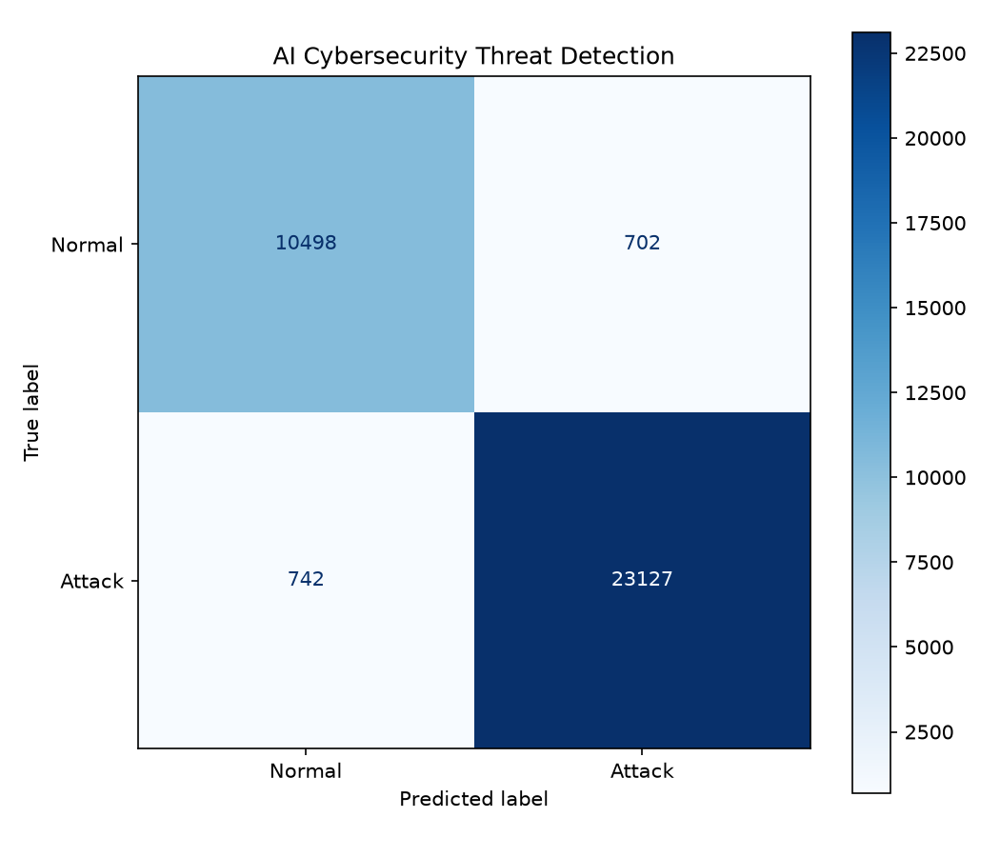
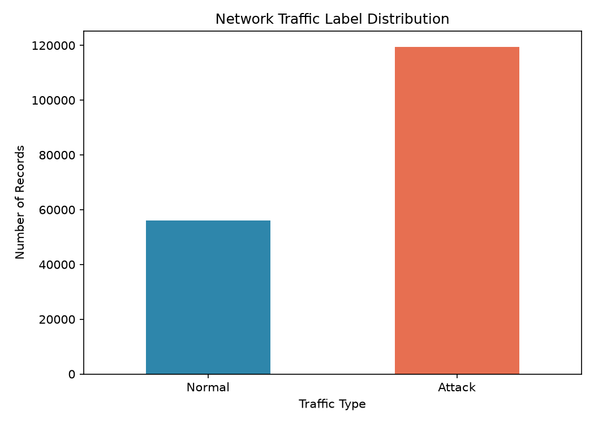

# 🛡️ AI Cybersecurity Threat Detection

A machine learning-based cybersecurity project that analyzes network traffic records and classifies them as **Normal** or **Potential Attack** using a trained Random Forest model.

The project includes a Flask web dashboard, model evaluation metrics, dataset visualizations, and a local prediction demo.

## 🚀 Live Demo

- **Hosted Dashboard:** https://ai-cybersecurity-threat-detection-3tvz.onrender.com
- **GitHub Repository:** https://github.com/vyshnaviporandla/AI-Cybersecurity-Threat-Detection

> **Demo status:** The hosted dashboard displays evaluation metrics and charts. The trained model and dataset are available locally, where sample loading and model-based predictions have been tested successfully. Predictions are not currently enabled on the hosted deployment.

## 🎯 Problem Statement

Network attacks and malicious traffic can threaten the confidentiality, integrity, and availability of computer systems. Identifying suspicious traffic is an important part of cybersecurity.

This project demonstrates how machine learning can help classify network traffic records using a model trained on a labeled dataset.

## ✨ Features

- **Machine Learning Classification:** Uses a trained Random Forest model to classify network traffic records.
- **Interactive Dashboard:** Provides a web interface built with Flask, HTML, CSS, and JavaScript.
- **Model Evaluation:** Displays accuracy, precision, recall, and F1-score.
- **Confusion Matrix:** Visualizes classification results from model evaluation.
- **Label Distribution:** Displays the distribution of normal and attack labels in the dataset.
- **Sample Data Loading:** Loads a sample network traffic record in the local demo.
- **Prediction Results:** Displays the model's classification for a supplied traffic record.
- **Hosted Dashboard:** Makes evaluation metrics and visualizations accessible online.

## 🧰 Technology Stack

| Technology | Purpose |
|---|---|
| Python | Core programming and machine learning |
| Pandas | Dataset processing |
| NumPy | Numerical operations |
| Scikit-learn | Random Forest and model evaluation |
| Joblib | Saving and loading the trained model |
| Flask | Backend API and web server |
| HTML, CSS, JavaScript | Dashboard interface |
| Matplotlib | Dataset and evaluation visualizations |
| Git and GitHub | Version control and source code hosting |
| Render | Dashboard deployment |

## 📊 Dataset

**Dataset:** UNSW-NB15 training dataset

The dataset contains network traffic records with features used for network intrusion detection research.

- Dataset file: `data/raw/UNSW_NB15_training-set.csv`
- Total records: 175,341
- Total columns: 45
- Target column: `label`
- `0`: Normal traffic
- `1`: Attack traffic

The project excludes the `label`, `attack_cat`, and `id` columns from the model input features.

Dataset source: [UNSW-NB15 Dataset — Australian Centre for Cyber Security](https://research.unsw.edu.au/projects/unsw-nb15-dataset)

## 📈 Model Evaluation Results

The trained model achieved the following results on the held-out evaluation dataset.

| Metric | Score |
|---|---:|
| Accuracy | 95.88% |
| Precision | 97.05% |
| Recall | 96.89% |
| F1-score | 96.97% |

These results describe performance on the evaluated dataset. They do not guarantee equivalent performance on new, real-world network traffic.

### Evaluation Visualizations

**Confusion Matrix**



**Label Distribution**



## 📁 Project Structure

```text
AI-Cybersecurity-Threat-Detection/
│
├── dashboard.py
├── app.py
├── requirements.txt
├── README.md
│
├── templates/
│   └── index.html
│
├── static/
│   ├── style.css
│   └── script.js
│
├── images/
│   ├── confusion_matrix.png
│   └── label_distribution.png
│
├── models/
│   └── threat_detector.joblib
│
├── data/
│   └── raw/
│       └── UNSW_NB15_training-set.csv
│
└── outputs/
    └── metrics/
        └── evaluation.json
```

Some local files, including the model, dataset, and evaluation JSON, may be excluded from Git or absent from the hosted deployment.

## ⚙️ Run the Project Locally

### Prerequisites

- Python installed on your computer
- Git (optional, for cloning the repository)
- The trained model and dataset files for local prediction functionality

### 1. Clone the repository

```bash
git clone https://github.com/vyshnaviporandla/AI-Cybersecurity-Threat-Detection.git
cd AI-Cybersecurity-Threat-Detection
```

### 2. Install dependencies

On Windows, you can use the Python launcher:

```cmd
py -m pip install -r requirements.txt
```

### 3. Start the dashboard

```cmd
py dashboard.py
```

If the dashboard starts successfully, open:

http://127.0.0.1:5001

Keep the terminal open while using the application.

### 4. Test a prediction

1. Open the local dashboard.
2. Select **Load sample**.
3. Confirm the sample features appear.
4. Click **Analyze traffic record**.
5. Review the classification result.

**Note:** The local dashboard requires the compatible trained model and dataset files. If those files are missing, prediction and sample-loading features will be unavailable.

## 🌐 Deployment

The dashboard is deployed using Render.

The current hosted version provides model evaluation metrics and chart visualizations. The model and dataset are not installed on the hosted service, so the prediction and sample endpoints are not currently available there.

## 🔒 Security and Limitations

- This is an educational machine learning demonstration, not a production intrusion detection system.
- Model predictions are estimates and do not prove that a real cyberattack is occurring.
- Evaluation results depend on the dataset and evaluation methodology.
- The hosted prediction feature requires additional model and dataset deployment configuration.
- Do not upload credentials, private data, or sensitive files to a public repository.
- Only use datasets and network records you are authorized to analyze.

## 🔮 Future Enhancements

- Enable secure model loading on the hosted dashboard.
- Restore hosted sample-data and prediction endpoints.
- Add prediction confidence and clearer result explanations.
- Improve validation and handling of network feature inputs.
- Add additional evaluation visualizations and test cases.
- Explore real-time network monitoring in a controlled, authorized environment.

## 👩‍💻 Author

**Vyshnavi Porandla**

B.Tech Computer Science and Engineering Student

GitHub: [vyshnaviporandla](https://github.com/vyshnaviporandla)

---

⭐ If you find this project useful, consider starring the repository.

